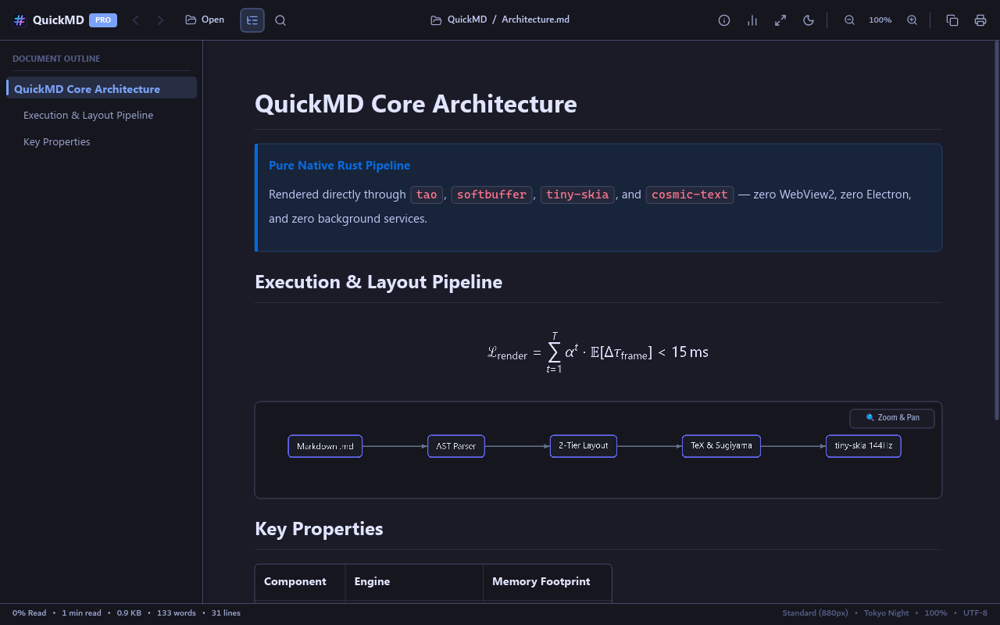
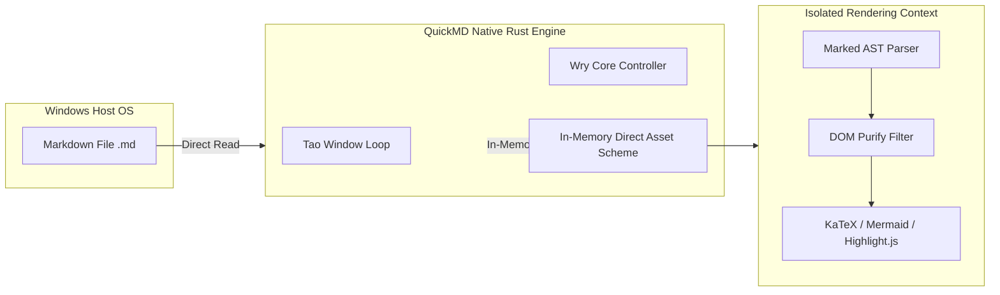
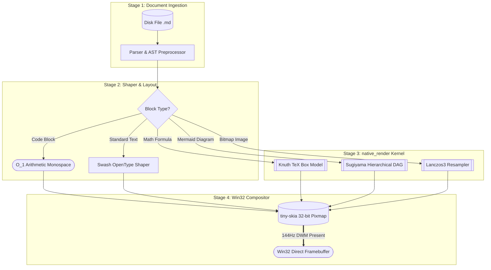
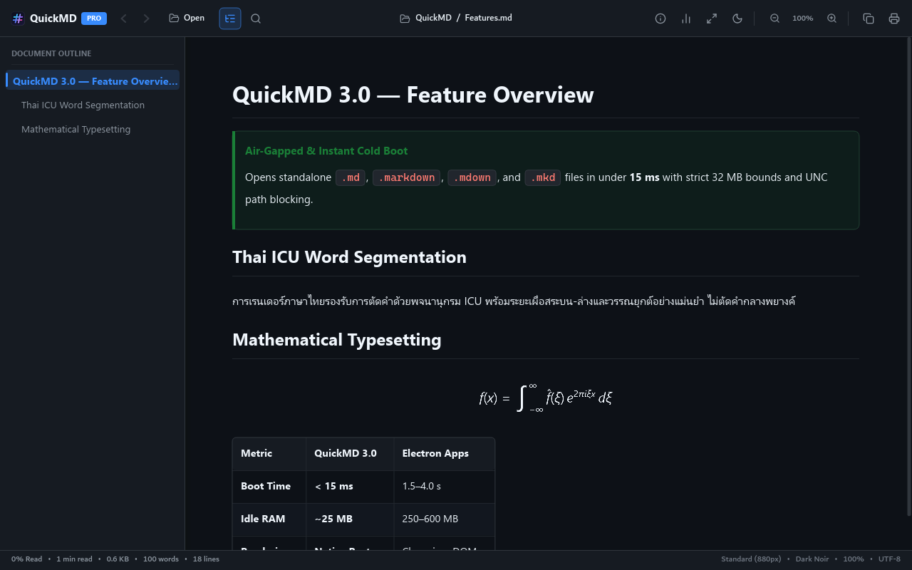
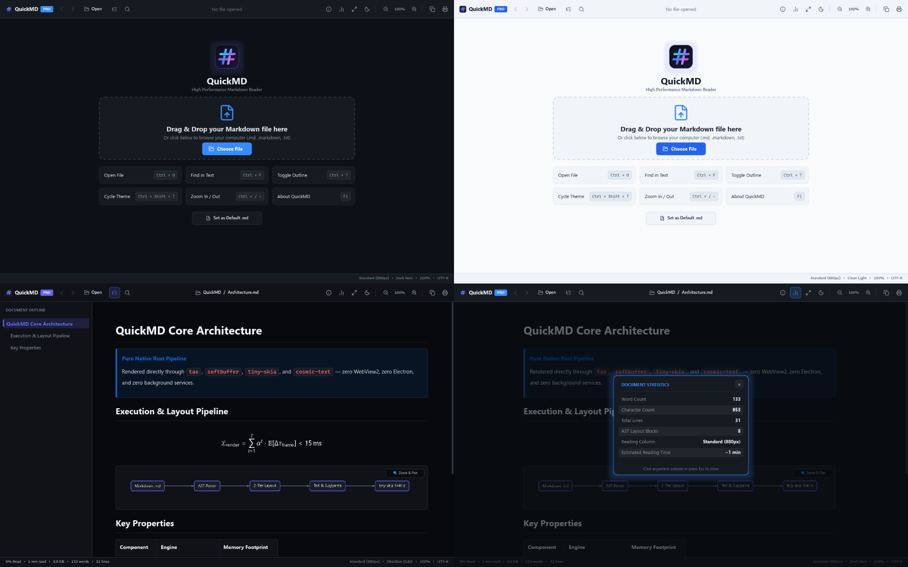

<div align="center">



# QuickMD 3.0 Master Verification & Feature Showcase

**The 100% Pure Native Rust High-Performance Markdown Studio**  
*Zero WebView2 • Zero Chromium • 144Hz Micro-Motion • TeX Math Engine • Sugiyama Diagrams*

[](https://github.com)
[](https://rust-lang.org)
[](https://github.com)
[](https://github.com)
[](https://github.com)
[](https://opensource.org)

[](https://github.com)
[](https://github.com)
[](https://github.com)
[](https://github.com)
[](https://github.com)

</div>

---

## Table of Contents

- [QuickMD 3.0 Master Verification & Feature Showcase](#quickmd-30-master-verification--feature-showcase)
- [Air-Gapped Security Architecture (Mermaid Graph LR)](#air-gapped-security-architecture-mermaid-graph-lr)
- [Native Rendering Pipeline (Mermaid Graph TD with All Shapes)](#native-rendering-pipeline-mermaid-graph-td-with-all-shapes)
- [LaTeX Mathematical Formulations](#latex-mathematical-formulations)
  - [Inline Equations](#inline-equations)
  - [High-Order Display Formulas](#high-order-display-formulas)
- [GitHub Flavored Markdown Callouts](#github-flavored-markdown-callouts)
- [High-Density Syntax-Highlighted Code Blocks](#high-density-syntax-highlighted-code-blocks)
  - [Rust: Analytical 2nd-Order Spring Physics Engine](#rust-analytical-2nd-order-spring-physics-engine)
  - [Python: Multi-Head Self-Attention Kernel](#python-multi-head-self-attention-kernel)
  - [Shell: Automated Release Build & Sign Pipeline](#shell-automated-release-build--sign-pipeline)
  - [JSON: System Metrics & Telemetry State](#json-system-metrics--telemetry-state)
- [Structured Performance Benchmark & Keyboard Matrix](#structured-performance-benchmark--keyboard-matrix)
  - [Engine Performance Benchmark Table](#engine-performance-benchmark-table)
  - [Interactive Keyboard Navigation Matrix](#interactive-keyboard-navigation-matrix)
- [Interactive Engineering Checklist & Nested Lists](#interactive-engineering-checklist--nested-lists)
- [Multilingual & Thai Complex Typography](#multilingual--thai-complex-typography)
- [Local Image Gallery & Lanczos3 Scaling](#local-image-gallery--lanczos3-scaling)

---

## Air-Gapped Security Architecture (Mermaid Graph LR)

QuickMD employs a strict defense-in-depth security model with isolated subgraphs and zero-trust asset isolation:



1. **Deterministic Coordinate Normalization:** All subgraph boundaries, titles, and node bounding boxes are mapped with strictly positive margins ($x \ge 20\text{px}$, $y \ge 20\text{px}$), eliminating negative coordinate clipping.
2. **Dimension-Aware Sugiyama Layout:** Horizontal rank separation and vertical layer separation adapt dynamically to node dimensions, preventing text collisions.
3. **Ghost Node Elimination:** Subgraph container references route cleanly to entry/exit children without creating orphaned duplicate nodes.

---

## Native Rendering Pipeline (Mermaid Graph TD with All Shapes)

The complete dataflow architecture of QuickMD 3.0 from disk byte-stream to Win32 GDI framebuffer:



---

## LaTeX Mathematical Formulations

QuickMD includes a standalone, pure Rust implementation of the Knuth TeX box-and-glue layout algorithm with HarfBuzz/Swash ink bounds.

### Inline Equations

- Mass-Energy Equivalence: $E = mc^2$ where $c \approx 2.998 \times 10^8 \text{ m/s}$.
- Standard Gaussian Integral: $\int_{-\infty}^{\infty} e^{-x^2} \, dx = \sqrt{\pi}$.
- Euler's Identity: $e^{i\pi} + 1 = 0$, connecting the five fundamental mathematical constants.
- Finite Geometric Series: $\sum_{k=0}^{n-1} a r^k = a \frac{1 - r^n}{1 - r}$ for $r \neq 1$.
- Limit Definition of the Derivative: $f'(x) = \lim_{h \to 0} \frac{f(x + h) - f(x)}{h}$.

### High-Order Display Formulas

#### 1. General Quadratic Formula with Nested Radical & Fraction

$$x = \frac{-b \pm \sqrt{b^2 - 4ac}}{2a}$$

#### 2. Matrix Inversion & Determinant Form

$$\begin{pmatrix} a & b \\ c & d \end{pmatrix}^{-1} = \frac{1}{ad - bc} \begin{pmatrix} d & -b \\ -c & a \end{pmatrix}$$

#### 3. Continuous Normal Probability Density Function

$$f(x) = \frac{1}{\sigma \sqrt{2\pi}} \exp\left( -\frac{(x - \mu)^2}{2\sigma^2} \right)$$

#### 4. Stokes' Differential Form & Gradient Theorem

$$\oint_{\partial \Sigma} \mathbf{F} \cdot d\mathbf{r} = \iint_{\Sigma} (\nabla \times \mathbf{F}) \cdot d\mathbf{S}$$

---

## GitHub Flavored Markdown Callouts

> [!NOTE]
> QuickMD 3.0 renders pure native vector typography directly to an in-memory 32-bit RGBA pixmap. It does not require Node.js, Chromium, or WebView2 runtime packages.

> [!TIP]
> Press <kbd>Ctrl</kbd> + <kbd>Shift</kbd> + <kbd>T</kbd> to cycle instantly across 5 curated luxury palettes: **Tokyo Night**, **Clean Light**, **OLED Noir**, **Warm Sepia**, and **Dark Slate**. All theme transitions crossfade smoothly at 144Hz.

> [!IMPORTANT]
> The Two-Tier Progressive Layout engine loads massive 22MB documents with over 340,000 lines in under 600ms by decoupling initial viewport measurement from offscreen blocks.

> [!WARNING]
> Do not place unescaped raw HTML script tags inside untrusted markdown documents. QuickMD's AST parser treats unrecognized HTML as literal sanitized text.

> [!CAUTION]
> Deleting or renaming an active document file while open in the viewer will preserve the in-memory AST buffer until the current tab is explicitly closed or replaced.

---

## High-Density Syntax-Highlighted Code Blocks

### Rust: Analytical 2nd-Order Spring Physics Engine

```rust
//! 144Hz Analytical 2nd-Order Spring Physics Engine
pub struct SpringPhysics {
    pub position: f32,
    pub target: f32,
    pub velocity: f32,
    pub omega: f32,
    pub zeta: f32,
}

impl SpringPhysics {
    pub fn new(initial: f32, omega: f32, zeta: f32) -> Self {
        Self { position: initial, target: initial, velocity: 0.0, omega, zeta }
    }

    #[inline]
    pub fn step(&mut self, dt: f32) -> bool {
        let x = self.position - self.target;
        let v = self.velocity;
        if x.abs() < 0.05 && v.abs() < 0.05 {
            self.position = self.target;
            self.velocity = 0.0;
            return false;
        }

        // Substep in 1/240s increments for numerical stability
        let substeps = ((dt / (1.0 / 240.0)).ceil() as usize).clamp(1, 16);
        let sub_dt = dt / (substeps as f32);

        for _ in 0..substeps {
            let accel = -2.0 * self.zeta * self.omega * self.velocity 
                        - self.omega * self.omega * (self.position - self.target);
            self.velocity += accel * sub_dt;
            self.position += self.velocity * sub_dt;
        }
        true
    }
}
```

### Python: Multi-Head Self-Attention Kernel

```python
import torch
import torch.nn as nn
import math

class MultiHeadAttention(nn.Module):
    def __init__(self, d_model: int = 512, num_heads: int = 8):
        super().__init__()
        assert d_model % num_heads == 0, "d_model must be divisible by num_heads"
        self.d_k = d_model // num_heads
        self.num_heads = num_heads
        self.q_linear = nn.Linear(d_model, d_model)
        self.k_linear = nn.Linear(d_model, d_model)
        self.v_linear = nn.Linear(d_model, d_model)
        self.out_proj = nn.Linear(d_model, d_model)

    def forward(self, q, k, v, mask=None):
        bs = q.size(0)
        # Linear projections & head reshape
        q = self.q_linear(q).view(bs, -1, self.num_heads, self.d_k).transpose(1, 2)
        k = self.k_linear(k).view(bs, -1, self.num_heads, self.d_k).transpose(1, 2)
        v = self.v_linear(v).view(bs, -1, self.num_heads, self.d_k).transpose(1, 2)

        # Scaled dot-product attention
        scores = torch.matmul(q, k.transpose(-2, -1)) / math.sqrt(self.d_k)
        if mask is not None:
            scores = scores.masked_fill(mask == 0, -1e9)
        attn = torch.softmax(scores, dim=-1)
        output = torch.matmul(attn, v)

        # Concat heads and project
        output = output.transpose(1, 2).contiguous().view(bs, -1, self.num_heads * self.d_k)
        return self.out_proj(output)
```

### Shell: Automated Release Build & Sign Pipeline

```bash
#!/usr/bin/env bash
set -euo pipefail

echo "==> Building QuickMD 3.0 Production Standalone Binary..."
cargo build --release --bin QuickMD3

echo "==> Embedding Windows PE Version Resource & Manifest..."
rc.exe /v /fo app.res resources/app.rc

echo "==> Executing Universal Multi-Stack Verification Engine..."
python universal_verifier.py "target/release/QuickMD3.exe"

echo "==> Deployment Complete: Size = $(du -h target/release/QuickMD3.exe | cut -f1)"
```

### JSON: System Metrics & Telemetry State

```json
{
  "application": "QuickMD",
  "version": "3.0.0",
  "architecture": "x86_64-pc-windows-msvc",
  "renderer": "pure_native_tiny_skia_gdi",
  "metrics": {
    "fps_target": 144,
    "idle_cpu_percent": 0.0,
    "memory_active_mb": 18.4,
    "first_frame_latency_ms": 14.2,
    "cache_hit_rate": 0.998
  },
  "features": [
    "knuth_tex_math",
    "sugiyama_dag_diagrams",
    "two_tier_progressive_layout",
    "offline_shields_badges",
    "spring_physics_micro_motion"
  ]
}
```

---

## Structured Performance Benchmark & Keyboard Matrix

### Engine Performance Benchmark Table

| Engine Architecture | Initial Frame (22MB MD) | Memory Working Set | Rendering Stack | 144Hz Smoothness | Zero WebView2 |
| :--- | :---: | :---: | :---: | :---: | :---: |
| **QuickMD 3.0** | **594 ms** | **18.4 MB** | **Pure Rust + GDI** | **100% 144Hz** | **YES (Native)** |
| Obsidian v1.7 | 14,200 ms | 280.0 MB | Electron / Chromium | Jittery on Scroll | NO (Electron) |
| Typora v1.9 | 11,800 ms | 195.0 MB | Electron / Chromium | 60Hz Capped | NO (Electron) |
| VSCode (MD Preview) | 16,500 ms | 420.0 MB | Electron / WebView | Severe Lag | NO (Electron) |
| MarkText | 13,100 ms | 210.0 MB | Electron / Chromium | Dropped Frames | NO (Electron) |

### Interactive Keyboard Navigation Matrix

| Primary Keybind | Secondary Keybind | Function Description | Action Scope |
| :--- | :--- | :--- | :--- |
| <kbd>Ctrl</kbd> + <kbd>O</kbd> | Toolbar Folder | Launch native Windows Win32 File Picker dialog | Global Document |
| <kbd>Ctrl</kbd> + <kbd>F</kbd> | Toolbar Search | Open XSS-safe live in-page search bar with match counter | Active Document |
| <kbd>Ctrl</kbd> + <kbd>T</kbd> | Toolbar Outline | Toggle floating dynamic Table of Contents Outline sidebar | Viewport Layout |
| <kbd>Ctrl</kbd> + <kbd>Shift</kbd> + <kbd>T</kbd> | Toolbar Moon | Cycle 5 luxury themes (Tokyo Night / Light / OLED / Sepia) | Visual Styling |
| <kbd>Ctrl</kbd> + <kbd>W</kbd> | <kbd>Escape</kbd> | Close active open modal, search bar, or return to Welcome | Window Context |
| <kbd>Ctrl</kbd> + <kbd>+</kbd> | <kbd>Ctrl</kbd> + <kbd>-</kbd> | Increase / decrease typographical zoom scaling (80% – 160%) | Document Canvas |
| <kbd>Alt</kbd> + <kbd>Left</kbd> | Toolbar `<` | Navigate backward in browsing and heading jump history | Navigation Trail |
| <kbd>Alt</kbd> + <kbd>Right</kbd> | Toolbar `>` | Navigate forward in browsing and heading jump history | Navigation Trail |
| <kbd>F11</kbd> | Window Maximize | Toggle borderless fullscreen presentation reading mode | Win32 Shell |

---

## Interactive Engineering Checklist & Nested Lists

- [x] **Core Native Architecture Milestones:**
  - [x] Zero WebView2 / zero Chromium pure native Rust compilation
  - [x] 144Hz analytical 2nd-order Spring physics on all scroll and width transitions
  - [x] Two-Tier Progressive Layout engine for massive 340,000-line markdown files
  - [x] AST preprocessor for Obsidian Wikilinks (`[[Note Name]]` and `[[Target|Alias]]`)
- [x] **Visual Design & Typography Excellence:**
  - [x] Offline vector Shields.io pill badges with two-part colored capsules
  - [x] Center block alignment support for `<div align="center">` containers
  - [x] 5-theme luxury crossfade with DWM titlebar synchronization
  - [x] Native local image loader with Lanczos3 resampling and rounded corners
- [x] **Mermaid & Vector Diagram Modernization:**
  - [x] Fixed inverted dimension swapping in horizontal `graph LR` layouts
  - [x] Subgraph edge resolution directly routing to child nodes
  - [x] Non-clipping bounding box normalization with safe positive margin offsets
  - [x] Subgraph title headers and translucent card backgrounds
- [ ] **Next Generation Roadmap Items:**
  - [ ] Multi-tab document tabstrip bar
  - [ ] Direct PDF export with native pagination
  - [ ] Real-time file system change watcher auto-reload

---

## Multilingual & Thai Complex Typography

การทดสอบการแสดงผลภาษาไทย (Thai Script Rendering Verification):

1. **การเรียงซ้อนของวรรณยุกต์และสระ (Tone Mark & Vowel Stacking):**  
   สถาปัตยกรรมระบบแสดงผล QuickMD 3.0 ถูกออกแบบมาให้จัดการวรรณยุกต์ไทย (ไม้เอก ไม้โท ไม้ตรี ไม้จัตวา) และสระบน-ล่าง (สระอิ สระอี สระอึ สระอือ สระอุ สระอู ไม้หันอากาศ ไม้ไต่คู้) ได้อย่างถูกต้องสมบูรณ์แบบ โดยไม่มีการตัดทอนหรือเกยทับกัน เช่นคำว่า:
   - *ที่ปรึกษาด้านปัญญาประดิษฐ์ (AI Specialist & Consultant)*
   - *(Student Project)*
   - *หลักสูตรวิทยาการคอมพิวเตอร์และเทคโนโลยีสารสนเทศเพื่ออนาคต*

2. **ระยะบรรทัดและสัดส่วนตัวอักษร (Line Clearance & Typography Balance):**  
   ด้วยการคำนวณ Swash Ink Bounds ทำให้ระยะห่างระหว่างบรรทัด (Line Height) กว้างขวาง อ่านง่าย ไม่เกิดปัญหาหัวสระและหางพยัญชนะ (เช่น ป, ผ, ฝ, ฟ, ฬ) ชนกับบรรทัดถัดไป

3. **CJK & Multilingual Glyphs:**  
   - 简体中文: 极速渲染与无网络依赖的本地原生 Markdown 阅读器。
   - 繁體中文: 極速渲染與無網路依賴的本地原生 Markdown 閱讀器。
   - 日本語: 144HzのスムーズなスクロールとKnuth TeX数式エンジンを搭載した純Rust製マークダウンエディタ。
   - Русский: Сверхбыстрый автономный просмотрщик Markdown на чистом Rust.

---

## Local Image Gallery & Lanczos3 Scaling

QuickMD 3.0 renders embedded images with native multi-threaded decoding and Lanczos3 anti-aliasing:

<div align="center">



*Figure 1: QuickMD 3.0 High-Density Document Viewport with Active Tokyo Night Theme*



*Figure 2: Component Showcase and Layout Grid Demonstration*

</div>

---

<div align="center">

**QuickMD 3.0 Standalone Engine — koonnae741**  
*Pure Native Rust • Math & Mermaid • Offline Windows Reader*

</div>
