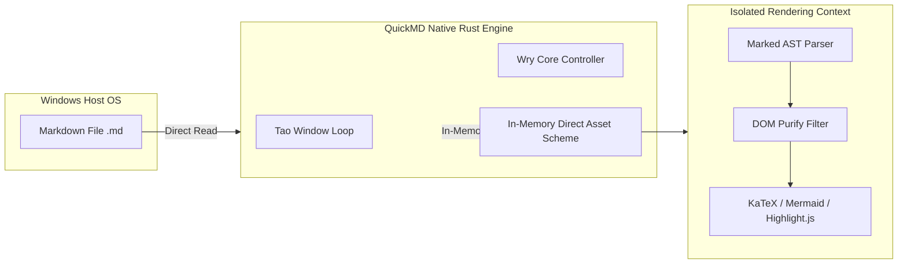

# QuickMD — High-Performance Native Markdown Reader for Windows

<p align="center">
  
</p>

<p align="center">
  <strong>"Double-click and read instantly. Exactly how a document viewer should work."</strong><br>
  The Ultra-Fast, Distraction-Free Native Markdown Reader for Windows 10 & 11
</p>

<p align="center">
  <a href="https://github.com/koonnae741/QuickMD/releases"></a>
  <a href="LICENSE"></a>
  
  
  
  
</p>

<p align="center">
  <strong>English</strong> | <a href="#ภาษาไทย-thai-version">ภาษาไทย</a>
</p>

---

<p align="center">
  
</p>

<p align="center">
  <em>QuickMD v2.0.0 rendering system architecture documentation in Tokyo Night theme with KaTeX math, Mermaid diagrams, and real-time outline sidebar.</em>
</p>

---

## The Problem: 5 Daily Frustrations with Modern Markdown Viewers

1. **Booting a Heavy IDE Just to Read a Single File**
   - You only want to inspect a README or API doc, but you have to wait 3–5 seconds for VS Code or a bloated IDE to launch, burning 400–800 MB of RAM loaded with editing toolbars you don't need.
2. **Note-Taking Apps Aren't Built to Be Standalone File Readers**
   - Downloaded an isolated `.md` file from GitHub or email? Apps like Obsidian or Notion force you to import it into a Vault or Workspace first before you can view it.
3. **The Electron Bloatware Tax**
   - Over 90% of modern Markdown readers wrap a full Chromium browser. Opening two or three tabs wastes nearly a gigabyte of memory, triggers laptop fans, and drains battery life.
4. **Broken International & Non-Latin Typography**
   - Most standard readers fail on non-Latin scripts (such as Thai or Asian languages)—vowels clip, accents float awkwardly, and words break across lines unnaturally, destroying readability.
5. **Basic Text Editors Show Raw Garbage**
   - Opening Markdown in Notepad leaves you staring at raw `#`, asterisks, and broken ASCII pipes. Mathematical formulas and architectural diagrams remain unreadable gibberish.

---

## The Solution: What is QuickMD?

**QuickMD** is a standalone, lightweight Markdown reader powered by a high-performance **Rust core (Tao + Wry)** paired with a modern sandboxed **WebView2** rendering engine for Windows 10 and 11. It has one singular mission: **to be the fastest, lightest, most beautiful, and most secure document reader in existence.**

No IDE bootup. No browser windows. No internet connection required. Simply double-click any `.md` file, and your formatted document appears in front of your eyes in milliseconds.

> **Author & Credits:** Created by **koonnae741**

---

## 7 Key Features of QuickMD

### 1. Sub-15ms Cold Boot Latency
Double-click and it's there. QuickMD launches in under 0.015 seconds—up to 56x faster than traditional Electron-based readers. Enjoy instant document rendering with zero white flash.

### 2. Featherweight Memory Footprint (~22 MB RAM)
Compiled to a compact native Windows binary with zero Node.js dependencies and zero lingering background daemons. When you close the window, 100% of your system resources are instantly released.

### 3. Flawless Multi-Language & Thai Typography
Equipped with an intelligent syllable segmentation and font-rendering engine. Zero vowel clipping, zero floating tone marks, and balanced paragraph kerning designed for fatigue-free extended reading.

### 4. Native Offline LaTeX Math & Live Diagrams
Render complex calculus, matrix algebra, and equations $\mathcal{L}_{RDT}$ via embedded **KaTeX**, alongside live **Mermaid** flowcharts and sequence diagrams. No external plugins, no setup, and 100% offline.

### 5. Smart GFM Tables with 1-Click "Copy as Markdown"
Full GitHub Flavored Markdown table support with buttery horizontal scrolling and an integrated **Copy Table** button. Grab structured tables with one click and paste directly into AI chats, code, or documentation.

### 6. 100% Air-Gapped Security & Privacy
Zero network ports, zero background web servers, zero internet access, and zero telemetry. All parser assets, fonts, and icons are embedded directly inside the compiled binary. Read confidential business proposals, proprietary source code, or private notes with complete peace of mind.

### 7. 5 Handcrafted Reading Themes
Switch instantly with the shortcut `Ctrl + Shift + T`:
- **Tokyo Night:** Deep indigo with vibrant pastel syntax highlights—ideal for nighttime technical reading.
- **Clean Light:** Paper-white, magazine-grade high contrast for daytime study and printing.
- **OLED Pure Black:** `#000000` pitch black pixels that eliminate light bleed and maximize laptop battery conservation.
- **Warm Sepia:** Cozy, low-blue-light tones designed to prevent eye strain during marathon reading sessions.
- **Classic Dark:** The familiar, clean GitHub documentation aesthetic.

---

## Interface & Theme Showcase

<p align="center">
  
</p>

| Theme | Best For | Description |
| :--- | :--- | :--- |
| **Tokyo Night** | Modern Coding | Deep indigo backdrop with vibrant cyan, purple, and pastel syntax accents. |
| **Clean Light** | Day Reading & Printing | Crisp paper-white contrast with refined typography for office and study environments. |
| **OLED Pure Black** | Maximum Efficiency | `#000000` pitch black background engineered for OLED displays and battery conservation. |
| **Warm Sepia** | Night Reading | Gentle warm tones designed to eliminate blue light strain during extended research sessions. |
| **Classic Dark** | Classic Markdown | The familiar GitHub documentation reading experience with high readability. |

---

## Head-to-Head Comparison Matrix

| Feature | QuickMD (Rust Core) | VS Code | Obsidian | Typora | Notepad |
| :--- | :---: | :---: | :---: | :---: | :---: |
| **Startup** | **< 15 ms** | ~3–5 sec | ~1–2 sec | ~1–2 sec | < 50 ms |
| **RAM** | **~25 MB** | ~500 MB | ~200 MB | ~180 MB | ~15 MB |
| **Single File** | **Instant Open** | Cluttered IDE | Needs Vault | Instant Open | Instant Open |
| **Math & Charts** | **KaTeX + Mermaid** | Needs Extension | Supported | Supported | Raw Text Only |
| **Thai Support** | **Native Engine** | Basic Wrap | Font-dependent | Font-dependent | No Breaking |
| **Installer** | **2.5 MB (MSI)** | ~90 MB | ~95 MB | ~80 MB | OS Built-in |
| **Network Ports** | **Zero Ports** | Internal Services | WebSockets | Background IPC | None |
| **License** | **Free (MIT)** | Free | Free / Sync Paid | Paid ($14.99) | Free |

---

## Air-Gapped Security Architecture

QuickMD employs a strict defense-in-depth security model:



1. **No Open Network Ports:** QuickMD does not bind to any network ports or local background daemons, preventing remote probing and unauthorized socket access.
2. **Strict Content Security Policy (CSP):** Prohibits inline arbitrary code evaluation, blocks external outbound network requests (`connect-src 'none'`), and isolates file reads to explicitly opened documents.
3. **Safe In-Page Search:** Unlike search tools that use naive HTML replacement, QuickMD uses pure DOM `TreeWalker` text-node traversal, completely preventing script injection while searching.

---

## Keyboard Shortcuts

| Shortcut | Action | Description |
| :--- | :--- | :--- |
| <kbd>Ctrl</kbd> + <kbd>O</kbd> | **Open File** | Launch native Windows file picker (`.md`, `.markdown`, `.txt`) |
| <kbd>Ctrl</kbd> + <kbd>F</kbd> | **In-Page Search** | Instant XSS-safe live document search with match counters |
| <kbd>Ctrl</kbd> + <kbd>T</kbd> | **Toggle Outline** | Show / hide dynamic document Table of Contents sidebar |
| <kbd>Ctrl</kbd> + <kbd>Shift</kbd> + <kbd>T</kbd> | **Cycle Theme** | Rotate through Tokyo Night, Clean Light, OLED, Sepia, and Dark |
| <kbd>Ctrl</kbd> + <kbd>+</kbd> / <kbd>-</kbd> | **Zoom In / Out** | Adjust document typography scaling (80% – 160%) |
| <kbd>Ctrl</kbd> + <kbd>0</kbd> | **Reset Zoom** | Restore typography scaling to default 100% |
| <kbd>Ctrl</kbd> + <kbd>I</kbd> | **Document Stats** | Display word count, reading time, characters, and headings |
| <kbd>Ctrl</kbd> + <kbd>P</kbd> | **Print / Export PDF** | Print document or export formatted PDF via system dialog |

---

## Who is QuickMD For?

1. **Software Engineers & DevOps:** Developers who want to quickly inspect a README, CHANGELOG, or architecture spec without opening a heavy IDE.
2. **Researchers & University Students:** Academics who read technical papers, study notes, LaTeX mathematical proofs, and system flowcharts.
3. **Technical Writers & Documentarians:** Professionals who demand flawless international typography and need one-click export to clean, formatted PDF.
4. **Privacy-Conscious Professionals:** Users who require 100% air-gapped guarantees that local documents will never be scanned, cached, or transmitted across network connections.

---

## Installation & Download

### Method 1: Windows Package Manager (WinGet)

Install directly from PowerShell or Command Prompt using the validated WinGet manifest:
```cmd
winget install --manifest installer/winget
```

---

### Method 2: Official Windows Installer (Recommended)

1. Download **[QuickMD-2.0.0-windows-x64.msi](https://github.com/koonnae741/QuickMD/releases/download/v2.0.0/QuickMD-2.0.0-windows-x64.msi)** from the [Releases](https://github.com/koonnae741/QuickMD/releases) page.
2. Run the installer. It will automatically:
   - Create Start Menu and Desktop shortcuts.
   - Add a right-click **"Open with QuickMD"** context menu in Windows Explorer.
   - Associate `.md` and `.markdown` files directly.

#### Package Integrity Verification
```powershell
Get-FileHash -Algorithm SHA256 "QuickMD-2.0.0-windows-x64.msi"
```
* **SHA-256 Checksum:** `5ee9c414d83e10f366b5dcb97cc85f80e57cb11770cb9a793e01ab77506861c4`
* **File Size:** `2,633,728 bytes` (2.51 MB)

---

### Method 3: Command Line Usage

Open any document directly from PowerShell or Command Prompt:
```cmd
QuickMD.exe "C:\Path\To\Document.md"
```

Register or unregister Windows file associations and context menu:
```cmd
QuickMD.exe --register
QuickMD.exe --unregister
```

---

## Building from Source

### Prerequisites
* **Rust:** 2024 Edition (v1.85+ recommended via `rustup`)
* **Windows SDK:** Windows 10/11 x64
* **LLVM-MinGW / Clang:** For PE icon resource compilation (`windres`)
* **WiX Toolset v3.11:** (Optional) For building the `.msi` Windows installer

### Build Commands
```cmd
# 1. Clone repository
git clone https://github.com/koonnae741/QuickMD.git
cd QuickMD

# 2. Build release binary with path sanitization
cargo build --release

# The compiled binary will be located at:
# target\release\QuickMD.exe
```

### Build MSI Installer
```cmd
candle.exe -nologo -arch x64 -out installer\QuickMD.wixobj installer\QuickMD.wxs
light.exe -nologo -ext WixUIExtension -sval -out installer\QuickMD-2.0.0-windows-x64.msi installer\QuickMD.wixobj
```

---
---

# ภาษาไทย (Thai Version)

> "ดับเบิลคลิกแล้วเปิดทันที เหมือนที่โปรแกรมอ่านเอกสารควรจะเป็น"

---

## ปัญหาเดิมๆ (Pain Points): 5 ความหงุดหงิดเวลาเปิดอ่านไฟล์ Markdown (.md)

1. **เปิดด้วย VS Code แค่จะอ่านไฟล์เดียว แต่ต้องรอโหลดทั้งระบบ**
   - แค่อยากเปิดอ่านคู่มือหรือ Readme สักไฟล์ แต่ต้องรอ IDE ตัวยักษ์เปิดขึ้นมา 3–5 วินาที พร้อมกินแรม 400 – 800 MB แถมเต็มไปด้วยแถบเครื่องมือเขียนโค้ดที่ไม่ได้ใช้
2. **Obsidian / Notion ไม่ได้เกิดมาเพื่อเป็น "File Reader"**
   - โหลดไฟล์ .md มาจากงานหรือ GitHub แต่เปิดอ่านตรงๆ ไม่ได้ ต้องคอยลากไฟล์ยัดเข้า Vault หรือ Import เข้า Workspace ให้รกระบบก่อนถึงจะอ่านได้
3. **โปรแกรมอื่นส่วนใหญ่เป็น Electron หนักเครื่อง ซดแบต**
   - โปรแกรมเปิดอ่าน Markdown ในตลาดเกือบ 90% ห่อหุ้มด้วยเบราว์เซอร์ Chromium เปิดทิ้งไว้ 3 หน้าต่าง แรมหายไปเกือบกิกะไบต์ เครื่องร้อน แบตเตอรี่โน้ตบุ๊กลดฮวบ
4. **ภาษาไทยสระลอย วรรณยุกต์เพี้ยน ตัดคำมั่ว**
   - ตัวเรนเดอร์ทั่วไปในท้องตลาดไม่ได้ออกแบบมาเพื่อภาษาไทย สระอำตกหล่น สระบน-ล่างซ้อนทับ ตัดบรรทัดกลางคำจนเสียความหมาย อ่านแล้วขัดตา เสียสมาธิ
5. **Notepad / Text Editor ธรรมดาอ่านไม่รู้เรื่อง**
   - เปิดด้วยโปรแกรมจดโน้ตพื้นฐานก็เห็นแต่โค้ดดิบ สัญลักษณ์ #, *, ตารางกระจัดกระจาย สูตรคณิตศาสตร์และไดอะแกรมกลายเป็นข้อความขยะ อ่านยาก

---

## ทางออก (The Solution): QuickMD คือใคร และเข้ามาแก้อะไร?

**QuickMD** คือโปรแกรมเปิดอ่านไฟล์ Markdown สแตนด์อโลนสำหรับ Windows 10/11 ที่ขับเคลื่อนด้วยแกนหลักภาษา **Rust (Tao + Wry)** ทำงานร่วมกับเอนจินเรนเดอร์ **WebView2** แบบ Sandboxed โดยมีเป้าหมายเดียวคือ: **"ต้องเร็วที่สุด เบาที่สุด สวยงามที่สุด และปลอดภัยที่สุดสำหรับการอ่านเอกสาร"**

ไม่ต้องเปิด IDE, ไม่ต้องเปิดเบราว์เซอร์, ไม่ต้องต่ออินเทอร์เน็ต แค่ดับเบิลคลิกไฟล์ .md ทุกอย่างจะปรากฏขึ้นตรงหน้าในเวลาไม่ถึงกระพริบตา

---

## 7 จุดเด่นสำคัญ (Key Features) ของ QuickMD

1. **ความเร็วระดับสูง (Cold Boot < 15 ms):** หน้าต่างเอกสารเด้งขึ้นมาทันทีในเวลาไม่ถึง 0.015 วินาที เร็วกว่าโปรแกรมตระกูล Electron ทั่วไปถึง 56 เท่า
2. **เบาหวิว กินแรมน้อยกว่าแท็บเบราว์เซอร์แท็บเดียว (~22 MB):** ทำงานด้วย Native Binary ขนาดเล็ก ไม่มี Node.js หรือ Background Services ทิ้งค้างไว้ในระบบ
3. **ระบบตัดคำและฟอนต์ภาษาไทยระดับพรีเมียม (Smart Thai Typography):** ตัดคำตามหลักไวยากรณ์ไทย สระไม่ลอย วรรณยุกต์ไม่ขาด สระอำไม่เพี้ยน
4. **รองรับสูตรคณิตศาสตร์และไดอะแกรมสด (Offline KaTeX & Mermaid):** เรนเดอร์สูตรเลข แคลคูลัส $\mathcal{L}_{RDT}$ และวาด Flowchart / Sequence Diagram ในตัวทันทีแบบออฟไลน์ 100%
5. **ตารางอัจฉริยะ พร้อมปุ่ม "Copy as Markdown" ในคลิกเดียว:** เลื่อนดูแนวนอนได้เนียนตา พร้อมปุ่มกดคัดลอกตารางไปใช้งานต่อได้ทันที
6. **ความเป็นส่วนตัวระดับสูงสุด (100% Air-Gapped Standalone):** ไม่เปิดพอร์ตเครือข่าย ไม่เปิดเว็บเซิร์ฟเวอร์หลังบ้าน และไม่มีระบบแอบเก็บข้อมูลผู้ใช้ (Zero Telemetry)
7. **ถนอมสายตาด้วย 5 ธีมระดับ Luxury:** สลับธีมได้ทันทีด้วยปุ่มลัด `Ctrl + Shift + T` (Tokyo Night, Clean Light, OLED Pure Black, Warm Sepia, Classic Dark)

---

## ตารางเปรียบเทียบเชิงสมรรถนะ (Head-to-Head Comparison)

| คุณสมบัติ | QuickMD (Rust Core) | VS Code | Obsidian | Typora | Notepad |
| :--- | :---: | :---: | :---: | :---: | :---: |
| **ความเร็วเปิด** | **< 15 ms** | ~3–5 วินาที | ~1–2 วินาที | ~1–2 วินาที | < 50 ms |
| **กินแรม (RAM)** | **~25 MB** | ~500 MB | ~200 MB | ~180 MB | ~15 MB |
| **เปิดไฟล์เดี่ยว** | **เปิดได้ทันที** | เมนูโค้ดรก | ต้องเข้า Vault | เปิดได้ทันที | เปิดได้ทันที |
| **สูตรเลข & กราฟ** | **KaTeX + Mermaid** | ต้องลงเสริม | รองรับในระบบ | รองรับในตัว | เห็นโค้ดดิบ |
| **ตัดคำภาษาไทย** | **ตัดคำเนียน** | สระลอยง่าย | ตัดคำไม่สมบูรณ์ | ตัดคำไม่สมบูรณ์ | ไม่ตัดคำ |
| **ขนาดติดตั้ง** | **2.5 MB (MSI)** | ~90 MB | ~95 MB | ~80 MB | มีในเครื่อง |
| **พอร์ตหลังบ้าน** | **ไม่มีพอร์ตเปิด** | มีเซอร์วิสภายใน | รัน WebSockets | รันโปรเซสเบื้องหลัง | ไม่มี |
| **ลิขสิทธิ์ใช้งาน** | **ฟรี (MIT)** | ฟรี | ฟรี / Sync เสียเงิน | เสียเงิน (~$14.99) | ฟรี |

---

## โปรแกรมนี้เหมาะกับใคร?

1. **นักพัฒนาซอฟต์แวร์ & โปรแกรมเมอร์:** ที่เบื่อการเปิด IDE ตัวยักษ์เพียงเพื่อจะเปิดเช็ค README.md, CHANGELOG.md หรือเอกสาร API
2. **นักวิจัย & นักศึกษา:** ที่ต้องอ่านเปเปอร์ สรุปบทความวิชาการ สูตรคณิตศาสตร์ KaTeX และไดอะแกรมสถาปัตยกรรมระบบ
3. **คนทำงานสาย Tech & Technical Writer:** ที่ต้องการโปรแกรมอ่าน Markdown ที่แสดงผลภาษาไทยได้ถูกต้อง 100% สระไม่เพี้ยน และสามารถสั่งพิมพ์เป็นเอกสาร PDF ได้สวยงาม
4. **ผู้ใช้งานที่ให้ความสำคัญกับความปลอดภัย (Privacy-Conscious):** มั่นใจได้ว่าข้อมูลในเอกสารจะไม่ถูกส่งออกนอกเครื่อง หรือถูกสแกนจากเซอร์วิสภายนอกเด็ดขาด

---

## ช่องทางการติดตั้ง (Installation)

- **ผ่านคำสั่ง WinGet:** `winget install --manifest installer/winget`
- **ผ่านไฟล์ติดตั้ง MSI:** `QuickMD-2.0.0-windows-x64.msi` (ขนาดเพียง 2.5 MB)
- **ระบบอัตโนมัติ:** ผูกสิทธิ์เปิดไฟล์ `.md` และเพิ่มเมนูคลิกขวา "Open with QuickMD" ใน Windows Explorer ให้อัตโนมัติ ถอนการติดตั้งได้สะอาดหมดจดผ่าน Windows Settings

---

## License

QuickMD is open-source software licensed under the **[MIT License](LICENSE)**.

Copyright (c) 2026 **koonnae741**. All rights reserved.
