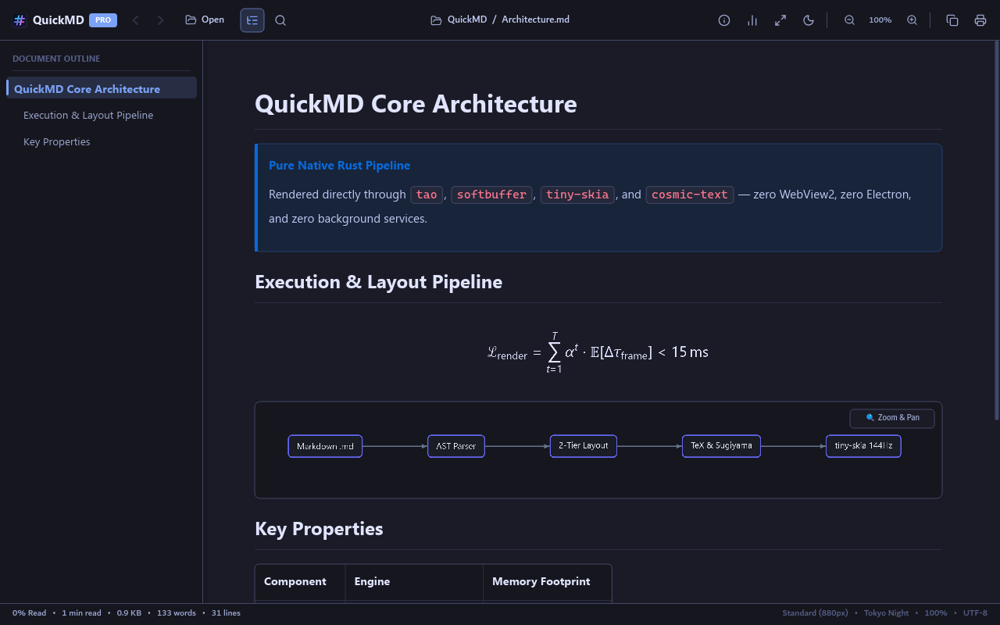
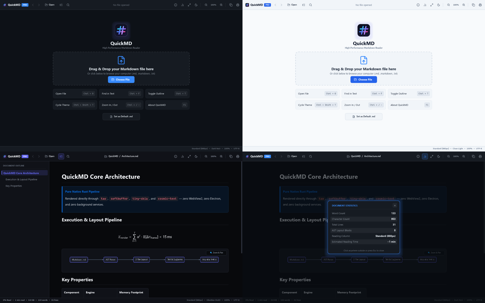
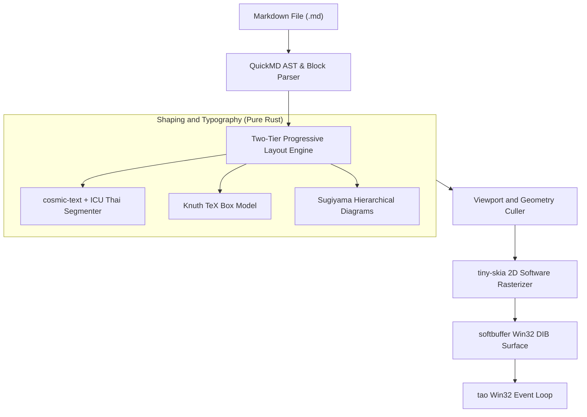
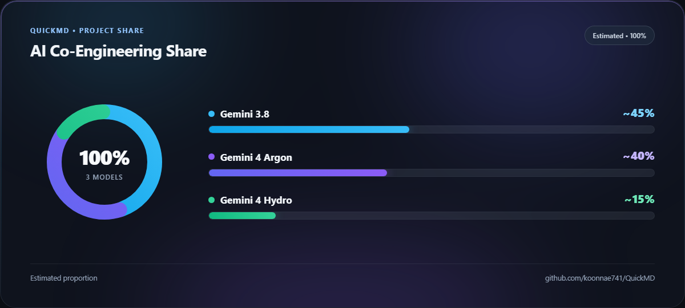

# QuickMD

<p align="center">
  
</p>

<p align="center">
  A lightweight, pure native Markdown reader for Windows 10 and 11.
</p>

<p align="center">
  <a href="https://github.com/koonnae741/QuickMD/releases"></a>
  <a href="LICENSE"></a>
  
  
  
  
</p>

<p align="center">
  <a href="#english">English</a> | <a href="#ภาษาไทย">ภาษาไทย</a>
</p>

---

<p align="center">
  
</p>

<p align="center">
  <em>QuickMD v3.0.0 rendering system architecture documentation in Tokyo Night theme with native math, Mermaid diagrams, and real-time outline sidebar.</em>
</p>

---

<a id="english"></a>
## English

QuickMD is a standalone Windows desktop reader for Markdown files. It renders documents directly using a custom Rust pipeline (`tao`, `softbuffer`, `tiny-skia`, and `cosmic-text`) rather than embedding Chromium, Node.js, or WebView2.

### Why QuickMD

Opening a single Markdown file often means either launching a heavy code editor like VS Code or importing the file into a note database like Obsidian. General-purpose editors also bundle full web engines, consuming several hundred megabytes of memory just to display text.

QuickMD addresses this by acting as a dedicated, lightweight viewer:
* Launches in under 15 milliseconds.
* Runs within roughly 25 MB of RAM.
* Opens any `.md` file directly from Windows Explorer without a project setup or import step.
* Contains zero network listeners, zero analytics, and zero external runtime dependencies.

---

### Features

#### Native rendering pipeline
QuickMD 3.0 does not use an embedded browser. Windowing and event handling run through `tao`. Text layout and shaping use `cosmic-text` with HarfBuzz. Vector graphics and 2D elements are rasterized into software buffers with `tiny-skia`, and rendered onto the Win32 window surface via `softbuffer`.

#### Progressive layout for large files
A two-tier layout engine measures visible blocks on initial load and hydrates remaining blocks dynamically as the user scrolls. Combined with row culling for tables and item culling for long lists, QuickMD maintains a consistent 144Hz scroll rate on documents exceeding 300,000 lines.

#### Offline math and diagrams
* **TeX math:** Formulas are parsed and formatted using a native implementation of the Knuth TeX box layout model.
* **Mermaid diagrams:** Flowcharts and sequence diagrams are positioned with a 4-pass Sugiyama layout algorithm and rendered directly. Clicking any diagram opens an interactive pan and zoom viewer with keyboard navigation.

#### Complex script typography
Integrates ICU dictionary-based word segmentation and vertical clearance adjustments for non-Latin scripts, including Thai. Vowels and tone marks render without vertical clipping or awkward mid-word breaks.

#### Reading themes
Includes five built-in themes switched via `Ctrl + Shift + T`:
* **Tokyo Night:** Dark slate blue background with syntax coloring.
* **Clean Light:** High-contrast neutral light theme for daytime reading.
* **OLED Pure Black:** Absolute black (`#000000`) background for OLED displays.
* **Warm Sepia:** Low-contrast warm tones for eye comfort.
* **Classic Dark:** GitHub-style dark grey palette.

#### Air-gapped security
* Does not open local network ports or run local web servers.
* Rejects remote UNC path lookups to prevent Windows NTLM hash leaks.
* Enforces size boundaries (32MB limit on file and image reads) to prevent memory exhaustion.

---

### Showcase

<p align="center">
  
</p>

| Theme | Background | Text Color | Intended Environment |
| :--- | :--- | :--- | :--- |
| **Tokyo Night** | `#1a1b26` | `#c0caf5` | Low-light coding and technical reading |
| **Clean Light** | `#f8f9fa` | `#24292f` | Daytime reading and printing |
| **OLED Pure Black** | `#000000` | `#e6edf3` | OLED panels and power saving |
| **Warm Sepia** | `#fbf0d9` | `#433422` | Long reading sessions |
| **Classic Dark** | `#0d1117` | `#c9d1d9` | Standard documentation style |

---

### Comparison

| Metric | QuickMD 3.0 | VS Code | Obsidian | Typora | Notepad |
| :--- | :---: | :---: | :---: | :---: | :---: |
| **Startup time** | **< 15 ms** | 2–4 s | 1–2 s | 1–2 s | < 50 ms |
| **RAM usage** | **~25 MB** | 400–800 MB | 180–300 MB | 150–250 MB | ~15 MB |
| **Standalone file open** | **Direct** | Cluttered IDE | Requires vault | Direct | Direct |
| **Math and diagrams** | **Native Rust** | Extension needed | Built-in (JS) | Built-in (JS) | Raw syntax only |
| **Thai text wrapping** | **ICU Dictionary** | Basic wrap | OS default | OS default | No dictionary wrap |
| **Installer size** | **4.5 MB (MSI)** | ~90 MB | ~95 MB | ~80 MB | Preinstalled |
| **Browser runtime** | **None** | Electron | Electron | Electron | None |
| **License** | **MIT** | MIT / Proprietary | Proprietary | Paid ($14.99) | Proprietary |

---

### Architecture



---

### Keyboard shortcuts

| Shortcut | Action | Notes |
| :--- | :--- | :--- |
| <kbd>Ctrl</kbd> + <kbd>O</kbd> | Open file | Launches the native file picker |
| <kbd>Ctrl</kbd> + <kbd>F</kbd> | Search | In-page text search with match counts |
| <kbd>Ctrl</kbd> + <kbd>T</kbd> | Toggle outline | Opens or closes the heading sidebar |
| <kbd>Ctrl</kbd> + <kbd>Shift</kbd> + <kbd>T</kbd> | Cycle theme | Rotates through the five built-in palettes |
| <kbd>Ctrl</kbd> + <kbd>+</kbd> / <kbd>-</kbd> | Zoom | Scales font size between 80% and 160% |
| <kbd>Ctrl</kbd> + <kbd>0</kbd> | Reset zoom | Returns font size to 100% |
| <kbd>Ctrl</kbd> + <kbd>I</kbd> | File info | Shows word count, character count, and read time |
| <kbd>Ctrl</kbd> + <kbd>P</kbd> | Print / PDF | Opens the system print dialog |
| <kbd>F11</kbd> | Fullscreen | Toggles borderless fullscreen mode |
| <kbd>Esc</kbd> | Close modal | Closes the search bar, info dialog, or diagram lightbox |

---

### Installation

#### Method 1: Windows Package Manager (WinGet)

```cmd
winget install --manifest installer/winget
```

#### Method 2: MSI installer

1. Download `QuickMD-3.0.0-windows-x64.msi` from the [Releases](https://github.com/koonnae741/QuickMD/releases) page.
2. Run the installer to configure Start Menu shortcuts, Explorer context menu integration, and file associations for `.md`, `.markdown`, `.mdown`, and `.mkd`.

```powershell
Get-FileHash -Algorithm SHA256 "QuickMD-3.0.0-windows-x64.msi"
# Expected: C0CDC1F42242537E7FDBF5A7479E6FB85FAE0E197F966586E3C4475BE0522E49
```

#### Method 3: Command line

Open a file directly:
```cmd
QuickMD3.exe "C:\Path\To\Document.md"
```

Register or unregister file associations:
```cmd
QuickMD3.exe --register
QuickMD3.exe --unregister
```

---

### Development Attribution

<p align="center">
  
</p>

| Model | Share (Est.) |
| :--- | :---: |
| **Gemini 3.8** | **~45%** |
| **Gemini 4 Argon** | **~40%** |
| **Gemini 4 Hydro** | **~15%** |

---

### Building from source

#### Requirements
* Rust 1.85+ (2024 edition)
* Windows SDK (Windows 10 or 11)
* WiX Toolset v3.11 (optional, required only for `.msi` packaging)

#### Steps
```cmd
# 1. Clone the repository
git clone https://github.com/koonnae741/QuickMD.git
cd QuickMD

# 2. Build the optimized release binary
cargo build --release

# The executable will be at target\release\QuickMD3.exe
```

To build the MSI installer:
```cmd
candle.exe -nologo -arch x64 -out installer\quickmd.wixobj installer\quickmd.wxs
light.exe -nologo -ext WixUIExtension -sval -out installer\QuickMD-3.0.0-windows-x64.msi installer\quickmd.wixobj
```

---
---

<a id="ภาษาไทย"></a>
# ภาษาไทย

QuickMD เป็นโปรแกรมเปิดอ่านไฟล์ Markdown สำหรับ Windows 10 และ 11 พัฒนาด้วยภาษา Rust ทั้งหมด โดยเรนเดอร์เนื้อหาผ่าน Win32 API ตรง (`tao`, `softbuffer`, `tiny-skia`, `cosmic-text`) ไม่มีการฝังเบราว์เซอร์ Chromium, Node.js หรือ WebView2

---

### จุดเด่นในการใช้งาน

* **เปิดไฟล์ทันที:** เปิดหน้าต่างเอกสารได้ในเวลาไม่ถึง 15 มิลลิวินาที
* **ใช้ทรัพยากรน้อย:** ใช้หน่วยความจำประมาณ 25 MB และคืนหน่วยความจำทั้งหมดทันทีเมื่อปิดหน้าต่าง
* **เปิดไฟล์เดี่ยวได้โดยตรง:** ดับเบิลคลิกไฟล์ `.md` จาก Windows Explorer ได้ทันทีโดยไม่ต้องสร้างโปรเจกต์หรือนำเข้า Vault
* **เรนเดอร์ภาษาไทยถูกต้อง:** ใช้ระบบตัดคำ ICU ร่วมกับการจัดตำแหน่งสระและวรรณยุกต์ ไม่ตัดคำกลางคำและสระไม่ทับซ้อน
* **สูตรคณิตศาสตร์และไดอะแกรมในตัว:** เรนเดอร์สูตร TeX ด้วย Knuth box model และวาดชาร์ต Mermaid ได้แบบออฟไลน์ พร้อมโหมดขยายดูภาพ (Lightbox)
* **ความปลอดภัยสูง:** ไม่มีส่วนเชื่อมต่อเครือข่าย ไม่ส่งข้อมูลออกภายนอก และป้องกันการดึงรหัสผ่านผ่านเส้นทาง UNC

---

### เปรียบเทียบกับโปรแกรมอื่น

| หัวข้อ | QuickMD 3.0 | VS Code | Obsidian | Typora | Notepad |
| :--- | :---: | :---: | :---: | :---: | :---: |
| **เวลาเริ่มทำงาน** | **< 15 ms** | 2–4 วินาที | 1–2 วินาที | 1–2 วินาที | < 50 ms |
| **หน่วยความจำ (RAM)** | **~25 MB** | 400–800 MB | 180–300 MB | 150–250 MB | ~15 MB |
| **เปิดอ่านไฟล์เดี่ยว** | **เปิดได้ทันที** | เปิดผ่าน IDE | ต้องนำเข้า Vault | เปิดได้ทันที | เปิดได้ทันที |
| **สูตรเลขและไดอะแกรม** | **Rust ในตัว** | ต้องลง Extension | รองรับ (JS) | รองรับ (JS) | แสดงโค้ดดิบ |
| **การตัดบรรทัดภาษาไทย** | **ICU Dictionary** | ตัดตามขอบหน้า | ตามระบบปฏิบัติการ | ตามระบบปฏิบัติการ | ไม่ตัดคำ |
| **ขนาดไฟล์ติดตั้ง** | **4.5 MB (MSI)** | ~90 MB | ~95 MB | ~80 MB | ติดตั้งพร้อม OS |
| **ระบบเรนเดอร์** | **Pure Native Rust** | Electron | Electron | Electron | Win32 Edit |
| **ลิขสิทธิ์** | **MIT** | MIT / เฉพาะทาง | ลิขสิทธิ์เฉพาะ | ซื้อสิทธิ์ขาด ($14.99) | ลิขสิทธิ์เฉพาะ |

---

### แป้นพิมพ์ลัด

| ปุ่มลัด | หน้าที่ | คำอธิบาย |
| :--- | :--- | :--- |
| <kbd>Ctrl</kbd> + <kbd>O</kbd> | เปิดไฟล์ | เรียกหน้าต่างเลือกไฟล์ของระบบ |
| <kbd>Ctrl</kbd> + <kbd>F</kbd> | ค้นหาข้อความ | ค้นหาคำในเอกสารพร้อมแสดงจำนวนคำที่พบ |
| <kbd>Ctrl</kbd> + <kbd>T</kbd> | แถบสารบัญ | แสดงหรือซ่อนแถบหัวข้อโครงสร้างเอกสาร |
| <kbd>Ctrl</kbd> + <kbd>Shift</kbd> + <kbd>T</kbd> | เปลี่ยนธีม | วนสลับธีม 5 รูปแบบ |
| <kbd>Ctrl</kbd> + <kbd>+</kbd> / <kbd>-</kbd> | ซูม | ปรับขนาดอักษรระหว่าง 80% ถึง 160% |
| <kbd>Ctrl</kbd> + <kbd>0</kbd> | คืนค่าซูม | ตั้งค่าขนาดอักษรกลับเป็น 100% |
| <kbd>Ctrl</kbd> + <kbd>I</kbd> | ข้อมูลเอกสาร | แสดงจำนวนคำ จำนวนตัวอักษร และเวลาอ่าน |
| <kbd>Ctrl</kbd> + <kbd>P</kbd> | พิมพ์ / PDF | เปิดหน้าต่างพิมพ์ของ Windows |
| <kbd>F11</kbd> | เต็มจอ | สลับโหมดแสดงผลเต็มหน้าจอ |
| <kbd>Esc</kbd> | ปิดหน้าต่างย่อย | ปิดช่องค้นหา หน้าต่างข้อมูล หรือตัวดูไดอะแกรม |

---

### การติดตั้ง

#### 1. ติดตั้งผ่าน WinGet
```cmd
winget install --manifest installer/winget
```

#### 2. ติดตั้งผ่านไฟล์ MSI
1. ดาวน์โหลดไฟล์ `QuickMD-3.0.0-windows-x64.msi` จากหน้า [Releases](https://github.com/koonnae741/QuickMD/releases)
2. เปิดไฟล์ติดตั้ง ระบบจะตั้งค่าทางลัดบน Desktop และเมนูคลิกขวา "Open with QuickMD" สำหรับไฟล์ `.md`, `.markdown`, `.mdown`, `.mkd`

ตรวจสอบความถูกต้องของไฟล์:
```powershell
Get-FileHash -Algorithm SHA256 "QuickMD-3.0.0-windows-x64.msi"
# ค่าที่ถูกต้อง: C0CDC1F42242537E7FDBF5A7479E6FB85FAE0E197F966586E3C4475BE0522E49
```

---

### สัดส่วนการพัฒนาร่วมกับ AI (ประมาณการ)

<p align="center">
  
</p>

| โมเดล | สัดส่วนโดยประมาณ |
| :--- | :---: |
| **Gemini 3.8** | **~45%** |
| **Gemini 4 Argon** | **~40%** |
| **Gemini 4 Hydro** | **~15%** |

---

### License

QuickMD พัฒนาภายใต้สัญญาอนุญาตแบบโอเพนซอร์ส [MIT License](LICENSE)

Copyright (c) 2026 **koonnae741**
