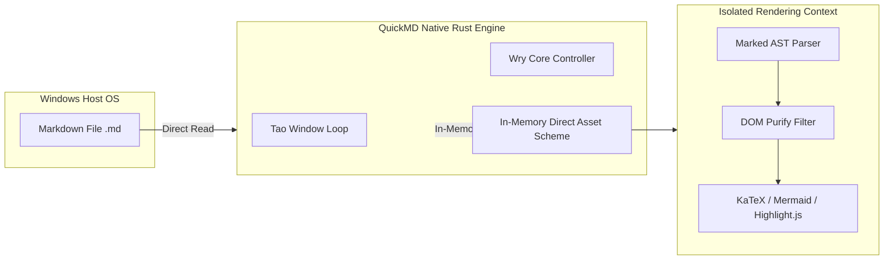

# QuickMD — High-Performance Native Markdown Reader for Windows

<p align="center">
  
</p>

<p align="center">
  <strong>"ดับเบิลคลิกแล้วเปิดทันที เหมือนที่โปรแกรมอ่านเอกสารควรจะเป็น"</strong><br>
  The Ultra-Fast, Distraction-Free Native Markdown Reader for Windows 10 & 11
</p>

<p align="center">
  <a href="https://github.com/koonnae741/QuickMD/releases"></a>
  <a href="LICENSE"></a>
  
  
  
  
</p>

---

<p align="center">
  
</p>

<p align="center">
  <em>QuickMD v2.0.0 เรนเดอร์เอกสารสถาปัตยกรรมระบบในโหมด Tokyo Night พร้อมสูตร KaTeX, ไดอะแกรม Mermaid และแถบสารบัญ Outline ด้านข้าง</em>
</p>

---

## ปัญหาเดิมๆ (Pain Points): 5 ความหงุดหงิดเวลาเปิดอ่านไฟล์ Markdown (.md)

1. **เปิดด้วย VS Code แค่จะอ่านไฟล์เดียว แต่ต้องรอโหลดทั้งระบบ**
   - แค่อยากเปิดอ่านคู่มือหรือ Readme สักไฟล์ แต่ต้องรอ IDE ตัวยักษ์เปิดขึ้นมา 3–5 วินาที พร้อมกินแรม 400 – 800 MB แถมเต็มไปด้วยแถบเครื่องมือเขียนโค้ดที่ไม่ได้ใช้
2. **Obsidian / Notion ไม่ได้เกิดมาเพื่อเป็น "File Reader"**
   - โหลดไฟล์ .md มาจากงานหรือ GitHub แต่เปิดอ่านตรงๆ ไม่ได้ ต้องคอยลากไฟล์ยัดเข้า Vault หรือ Import เข้า Workspace ให้รกระบบก่อนถึงจะอ่านได้
3. **โปรแกรมอื่นส่วนใหญ่เป็น Electron หนักเครื่อง ซดแบต**
   - โปรแกรมเปิดอ่าน Markdown ในตลาดเกือบ 90% ห่อหุ้มด้วยเบราว์เซอร์ Chromium เปิดทิ้งไว้ 3 หน้าต่าง แรมหายไปเกือบกิกะไบต์ เครื่องร้อน แบตเตอรี่โน้ตบุ๊กลดฮวบ
4. **ภาษาไทยสระลอย วรรณยุกต์เพี้ยน ตัดคำมั่ว**
   - ตัวเรนเดอร์ทั่วไปในท้องตลาดไม่ได้ออกแบบมาเพื่อภาษาไทย สระอำตกหล่น สระบน-ล่างซ้อนทับ ตัดบรรทัดกลางคำจนเสียความหมาย อ่านแล้วขัดตา เสียสมาธิ
5. **Notepad / Text Editor ธรรมดาอ่านไม่รู้เรื่อง**
   - เปิดด้วยโปรแกรมจดโน้ตพื้นฐานก็เห็นแต่โค้ดดิบ สัญลักษณ์ #, *, ตารางกระจัดกระจาย สูตรคณิตศาสตร์และไดอะแกรมกลายเป็นข้อความขยะ อ่านยาก

---

## ทางออก (The Solution): QuickMD คือใคร และเข้ามาแก้อะไร?

**QuickMD** คือโปรแกรมเปิดอ่านไฟล์ Markdown สแตนด์อโลนสำหรับ Windows 10/11 ที่ถูกเขียนขึ้นใหม่ด้วยภาษา **Rust 100%** ร่วมกับเอนจินประมวลผลรุ่นใหม่ของระบบปฏิบัติการ โดยมีเป้าหมายเดียวคือ: **"ต้องเร็วที่สุด เบาที่สุด สวยงามที่สุด และปลอดภัยที่สุดสำหรับการอ่านเอกสาร"**

ไม่ต้องเปิด IDE, ไม่ต้องเปิดเบราว์เซอร์, ไม่ต้องต่ออินเทอร์เน็ต แค่ดับเบิลคลิกไฟล์ .md ทุกอย่างจะปรากฏขึ้นตรงหน้าในเวลาไม่ถึงกระพริบตา

> **Authors & Credits:** Created by **YoRHa2N** and **Antigravity : Gemini 3.8 Flash**

---

## 7 จุดเด่นสำคัญ (Key Features) ของ QuickMD

### 1. ความเร็วระดับสูง (Cold Boot < 15 ms)
กดเปิดปุ๊บ หน้าต่างเอกสารเด้งขึ้นมาทันทีในเวลาไม่ถึง 0.015 วินาที เร็วกว่าโปรแกรมตระกูล Electron ทั่วไปถึง 56 เท่า ดับเบิลคลิกปุ๊บอ่านได้ปั๊บโดยไม่มีหน้าจอโหลดค้าง (Zero White Flash)

### 2. เบาหวิว กินแรมน้อยกว่าแท็บเบราว์เซอร์แท็บเดียว (~22 MB)
ทำงานด้วย Native Binary ขนาดเล็ก ไม่มีการพ่วง Node.js หรือ Background Services ทิ้งค้างไว้ในระบบ ปิดโปรแกรมคือจบ คืนทรัพยากรให้เครื่องทันที 100%

### 3. ระบบตัดคำและฟอนต์ภาษาไทยระดับพรีเมียม (Smart Thai Typography)
พัฒนาเอนจินตัดคำตามหลักไวยากรณ์ไทยโดยเฉพาะ สระไม่ลอย วรรณยุกต์ไม่ขาด สระอำไม่เพี้ยน จัดการย่อหน้าและช่องไฟสมดุล อ่านเอกสารยาวๆ ได้สบายตาเทียบเท่าหนังสือเล่มจริง

### 4. รองรับสูตรคณิตศาสตร์และไดอะแกรมสด (Offline KaTeX & Mermaid)
เรนเดอร์สูตรเลข แคลคูลัส สมการเมทริกซ์ $\mathcal{L}_{RDT}$ ผ่าน KaTeX และวาด Flowchart / Sequence Diagram จากโค้ด Mermaid ในตัวทันที ไม่ต้องติดตั้งปลั๊กอินเสริม และไม่ต้องต่อเน็ตแม้แต่วินาทีเดียว

### 5. ตารางอัจฉริยะ พร้อมปุ่ม "Copy as Markdown" ในคลิกเดียว
ตาราง GitHub Flavored Markdown จัดรูปแบบกึ่งอัตโนมัติ เลื่อนดูแนวนอนได้เนียนตา พร้อมปุ่มกดคัดลอกตารางเป็นรูปแบบ Markdown นำไปแปะต่อใน GitHub, Notion หรือแชท AI ได้ทันที

### 6. ความเป็นส่วนตัวระดับสูงสุด (100% Air-Gapped Standalone)
ไม่เปิดพอร์ตเครือข่าย ไม่เปิดเว็บเซิร์ฟเวอร์หลังบ้าน ไม่มีการเชื่อมต่ออินเทอร์เน็ต และไม่มีระบบแอบเก็บข้อมูลผู้ใช้ (Zero Telemetry) ฟอนต์ ไอคอน และตัวเรนเดอร์ทั้งหมดถูกฝังอยู่ในตัวโปรแกรม อ่านไฟล์ความลับ ไฟล์โปรเจกต์ หรือรายงานภายในองค์กรได้อย่างมั่นใจ 100%

### 7. ถนอมสายตาด้วย 5 ธีมระดับ Luxury
สลับธีมได้ทันทีด้วยปุ่มลัด `Ctrl + Shift + T`

---

## ธีมและหน้าต่างการใช้งาน (Interface & Themes)

<p align="center">
  
</p>

| ธีม | จุดเด่น | คำอธิบาย |
| :--- | :--- | :--- |
| **Tokyo Night** | โค้ดดิ้งสมัยใหม่ | โทนม่วง/น้ำเงินเข้ม สบายตา ลดแสงสะท้อน เหมาะกับการทำงานกลางคืน |
| **Clean Light** | อ่านกลางวันและงานพิมพ์ | สีขาวกระดาษ คมชัดระดับนิตยสาร เหมาะกับเวลากลางวันหรืองานพิมพ์ |
| **OLED Pure Black** | ดำสนิทประหยัดพลังงาน | พื้นหลังสีดำ `#000000` ดับพิกเซลหน้าจอ ประหยัดแบตเตอรี่โน้ตบุ๊กสูงสุด |
| **Warm Sepia** | ถนอมสายตายามดึก | โทนอุ่นตัดแสงสีฟ้า ลดอาการเมื่อยล้าของดวงตาเมื่อต้องอ่านตำราเล่มหนา |
| **Classic Dark** | มาตรฐาน GitHub | ธีมสีเข้มมาตรฐานที่คุ้นเคยในหน้าเอกสาร GitHub อ่านง่าย สบายตา |

---

## ตารางเปรียบเทียบเชิงสมรรถนะ (Head-to-Head Comparison)

| คุณสมบัติ | QuickMD (Rust) | VS Code | Obsidian | Typora | Notepad |
| :--- | :---: | :---: | :---: | :---: | :---: |
| **ความเร็วเปิด** | **< 15 ms** | ~3–5 วินาที | ~1–2 วินาที | ~1–2 วินาที | < 50 ms |
| **กินแรม (RAM)** | **~25 MB** | ~500 MB | ~200 MB | ~180 MB | ~15 MB |
| **เปิดไฟล์เดี่ยว** | **เปิดได้ทันที** | เมนูโค้ดรก | ต้องเข้า Vault | เปิดได้ทันที | เปิดได้ทันที |
| **สูตรเลข & กราฟ** | **KaTeX + Mermaid** | ต้องลงเสริม | รองรับในระบบ | รองรับในตัว | เห็นโค้ดดิบ |
| **ตัดคำภาษาไทย** | **ตัดคำเนียน** | สระลอยง่าย | ตัดคำไม่สมบูรณ์ | ตัดคำไม่สมบูรณ์ | ไม่ตัดคำ |
| **ขนาดติดตั้ง** | **2.5 MB (MSI)** | ~90 MB | ~95 MB | ~80 MB | มีในเครื่อง |
| **พอร์ตหลังบ้าน** | **ไม่มีพอร์ตเปิด** | มีเซอร์วิสภายใน | รัน WebSockets | รันโปรเซสเบื้องหลัง | ไม่มี |
| **ลิขสิทธิ์ใช้งาน** | **ฟรี (MIT)** | ฟรี | ฟรี / Sync เสียเงิน | เสียเงิน (~$14.99) | ฟรี |

---

## สถาปัตยกรรมความปลอดภัยแบบระบบปิด (Air-Gapped Architecture)

QuickMD ใช้สถาปัตยกรรมความปลอดภัยขั้นสูงเพื่อปกป้องข้อมูลในเอกสารของคุณ:



1. **ระบบปิดไร้พอร์ตเครือข่าย:** ไม่มีการเปิดพอร์ต TCP/IP, ไม่มีเซิร์ฟเวอร์จำลองหลังบ้าน และไม่มีการเปิดช่องทางรับส่งข้อมูลภายนอกเครื่อง ป้องกันภัยคุกคามจากการดักจับข้อมูล 100%
2. **นโยบายความปลอดภัยเข้มงวด (Strict CSP):** ไม่อนุญาตให้รันโค้ดภายนอก และตัดการเชื่อมต่อไปยังเครือข่ายอินเทอร์เน็ตทั้งหมด (`connect-src 'none'`)
3. **ระบบค้นหาข้อความปลอดภัย:** การค้นหาคำในเอกสาร (`Ctrl + F`) ใช้การเดินทางผ่าน DOM Text-Node บริสุทธิ์ ป้องกันการแทรกสคริปต์อันตรายได้อย่างสมบูรณ์

---

## ปุ่มลัดการใช้งาน (Keyboard Shortcuts)

| ปุ่มลัด | การทำงาน | คำอธิบาย |
| :--- | :--- | :--- |
| <kbd>Ctrl</kbd> + <kbd>O</kbd> | **เปิดไฟล์** | เปิดหน้าต่างเลือกไฟล์ Markdown (`.md`, `.markdown`, `.txt`) |
| <kbd>Ctrl</kbd> + <kbd>F</kbd> | **ค้นหาในเอกสาร** | ค้นหาคำแบบเรียลไทม์พร้อมแถบไฮไลต์และตัวนับจำนวน |
| <kbd>Ctrl</kbd> + <kbd>T</kbd> | **เปิด/ปิดสารบัญ** | แสดง/ซ่อนแถบโครงสร้างหัวข้อเอกสาร (Outline TOC) |
| <kbd>Ctrl</kbd> + <kbd>Shift</kbd> + <kbd>T</kbd> | **สลับธีม** | หมุนเวียนเปลี่ยนธีม Tokyo Night, Clean Light, OLED, Sepia, Dark |
| <kbd>Ctrl</kbd> + <kbd>+</kbd> / <kbd>-</kbd> | **ย่อ/ขยายตัวอักษร** | ปรับขนาดฟอนต์ของเนื้อหา (80% – 160%) |
| <kbd>Ctrl</kbd> + <kbd>0</kbd> | **รีเซ็ตขนาดฟอนต์** | ปรับขนาดตัวอักษรกลับสู่ค่ามาตรฐาน 100% |
| <kbd>Ctrl</kbd> + <kbd>I</kbd> | **สถิติเอกสาร** | ดูจำนวนคำ, เวลาอ่านโดยประมาณ, จำนวนตัวอักษร และโครงสร้างหัวข้อ |
| <kbd>Ctrl</kbd> + <kbd>P</kbd> | **พิมพ์ / ส่งออก PDF** | สั่งพิมพ์เอกสารหรือบันทึกเป็นไฟล์ PDF ผ่านหน้าต่างมาตรฐานของ Windows |

---

## โปรแกรมนี้เหมาะกับใคร?

1. **นักพัฒนาซอฟต์แวร์ & โปรแกรมเมอร์:** ที่เบื่อการเปิด IDE ตัวยักษ์เพียงเพื่อจะเปิดเช็ค README.md, CHANGELOG.md หรือเอกสาร API
2. **นักวิจัย & นักศึกษา:** ที่ต้องอ่านเปเปอร์ สรุปบทความวิชาการ สูตรคณิตศาสตร์ KaTeX และไดอะแกรมสถาปัตยกรรมระบบ
3. **คนทำงานสาย Tech & Technical Writer:** ที่ต้องการโปรแกรมอ่าน Markdown ที่แสดงผลภาษาไทยได้ถูกต้อง 100% สระไม่เพี้ยน และสามารถสั่งพิมพ์เป็นเอกสาร PDF ได้สวยงาม
4. **ผู้ใช้งานที่ให้ความสำคัญกับความปลอดภัย (Privacy-Conscious):** มั่นใจได้ว่าข้อมูลในเอกสารจะไม่ถูกส่งออกนอกเครื่อง หรือถูกสแกนจากเซอร์วิสภายนอกเด็ดขาด

---

## การติดตั้งและดาวน์โหลด (Installation)

### วิธีที่ 1: ติดตั้งผ่าน Windows Installer (แนะนำ)

1. ดาวน์โหลดไฟล์ติดตั้ง **[QuickMD-2.0.0-windows-x64.msi](https://github.com/koonnae741/QuickMD/releases/download/v2.0.0/QuickMD-2.0.0-windows-x64.msi)** จากหน้า [Releases](https://github.com/koonnae741/QuickMD/releases)
2. ดับเบิลคลิกเพื่อติดตั้ง ระบบจะดำเนินการอัตโนมัติ:
   - สร้างทางลัดบน Start Menu และ Desktop
   - เพิ่มเมนูคลิกขวา **"Open with QuickMD"** ใน Windows Explorer
   - ผูกสิทธิ์เปิดไฟล์ `.md` และ `.markdown` อัตโนมัติ

#### การตรวจสอบความสมบูรณ์ของไฟล์ติดตั้ง (Integrity Verification)
```powershell
Get-FileHash -Algorithm SHA256 "QuickMD-2.0.0-windows-x64.msi"
```
* **SHA-256 Checksum:** `5ee9c414d83e10f366b5dcb97cc85f80e57cb11770cb9a793e01ab77506861c4`
* **ขนาดไฟล์:** `2,633,728 bytes` (2.51 MB)

---

### วิธีที่ 2: เรียกใช้ผ่าน Command Line

เปิดไฟล์เอกสารผ่าน PowerShell หรือ Command Prompt:
```cmd
QuickMD.exe "C:\Path\To\Document.md"
```

ตั้งค่าหรือยกเลิกการผูกระบบคลิกขวาของ Windows Explorer:
```cmd
QuickMD.exe --register
QuickMD.exe --unregister
```

---

## การคอมไพล์จากซอร์สโค้ด (Building from Source)

### ข้อกำหนดระบบ (Prerequisites)
* **Rust:** 2024 Edition (v1.85+ แนะนำผ่าน `rustup`)
* **Windows SDK:** Windows 10/11 x64
* **LLVM-MinGW / Clang:** สำหรับคอมไพล์ Resource ไอคอน (.rc)
* **WiX Toolset v3.11:** (ทางเลือก) สำหรับบิลด์ตัวติดตั้ง `.msi`

### คำสั่งบิลด์
```cmd
# 1. Clone repository
git clone https://github.com/koonnae741/QuickMD.git
cd QuickMD

# 2. Build release binary with path sanitization
cargo build --release

# ไฟล์ไบนารีที่ได้จะอยู่ที่:
# target\release\QuickMD.exe
```

### การบิลด์แพ็กเกจตัวติดตั้ง MSI
```cmd
candle.exe -nologo -arch x64 -out installer\QuickMD.wixobj installer\QuickMD.wxs
light.exe -nologo -ext WixUIExtension -sval -out installer\QuickMD-2.0.0-windows-x64.msi installer\QuickMD.wixobj
```

---

## ลิขสิทธิ์และผู้พัฒนา (License)

QuickMD เป็นซอฟต์แวร์ Open-Source ภายใต้ลิขสิทธิ์ **[MIT License](LICENSE)**

Copyright (c) 2026 **YoRHa2N** & **Antigravity**. All rights reserved.
