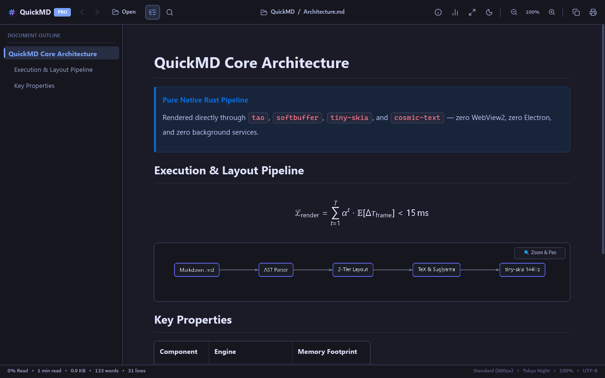

## QuickMD 3.0.0: Native Rust Markdown reader for Windows

QuickMD 3.0 replaces the previous WebView2-based architecture with a pure Rust rendering engine. It runs directly on the Win32 API without an embedded browser, Node.js, or background services.

### Changes in this release

* **Pure Rust rendering engine:** Replaced WebView2 and Wry with `tao`, `softbuffer`, `tiny-skia`, and `cosmic-text`. The application no longer requires `WebView2Loader.dll` or the Microsoft Edge runtime.
* **Large document layout:** Introduced a two-tier layout engine that measures the initial viewport on load and hydrates offscreen blocks dynamically. Includes row culling for tables and item culling for lists, allowing smooth scrolling on documents with over 300,000 lines.
* **Offline math and diagrams:** Added a native Knuth TeX box shaper for mathematical formulas and a Sugiyama layout engine for Mermaid diagrams. Clicking a diagram opens an interactive pan and zoom viewer.
* **Thai text handling:** Integrated ICU dictionary word segmentation with vertical clearance for vowels and tone marks to prevent character clipping.
* **Local security bounds:** Enforces a 32MB limit on document and image loading, restricts diagram graph sizes, and blocks UNC path lookups to prevent NTLM credential leaks.
* **Windows installer:** Built a 64-bit MSI package that registers file associations for `.md`, `.markdown`, `.mdown`, and `.mkd` files along with an Explorer context menu entry.
* **Default `.md` UI & hardened launch security:** Added an auto-hiding "Set as Default .md" button (Welcome screen and About modal) backed by Windows `UserChoiceLatest` detection, tightened percent-encoded UNC/device path rejection, removed `.svg` from shell launch allowlists, and enforced System32 path resolution for external commands.

### Verification and checksums

* **Installer:** `QuickMD-3.0.0-windows-x64.msi`
* **File size:** 4,734,976 bytes (4.52 MB)
* **SHA-256:** `C0CDC1F42242537E7FDBF5A7479E6FB85FAE0E197F966586E3C4475BE0522E49`

* **Standalone binary:** `QuickMD3.exe`
* **File size:** 7,552,000 bytes (7.20 MB)
* **SHA-256:** `89FE2D9A1E8D6B04F89B183B9026039140F7868D6B5C8F156168746C5A5E35C7`
* **Target:** `x86_64-pc-windows-msvc`
